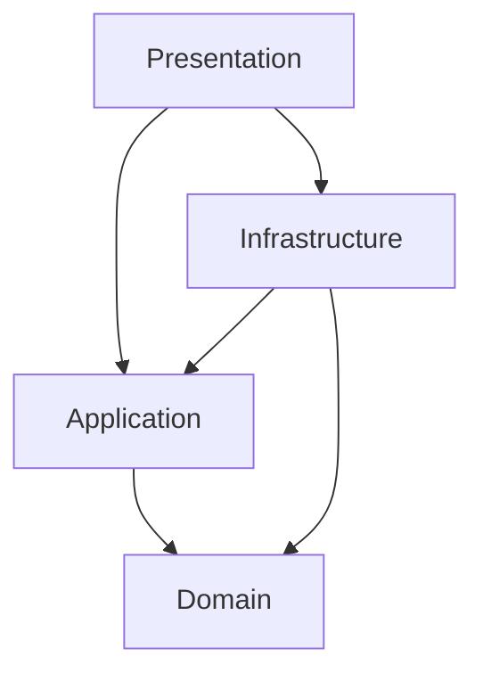
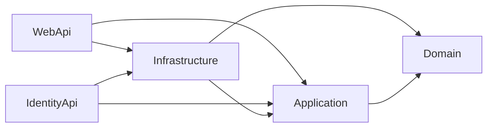
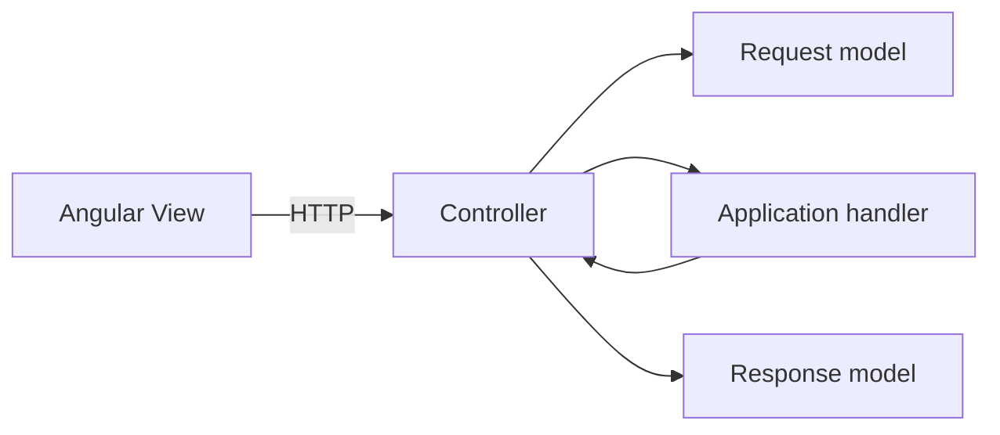
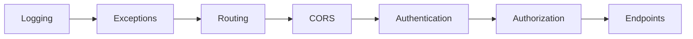
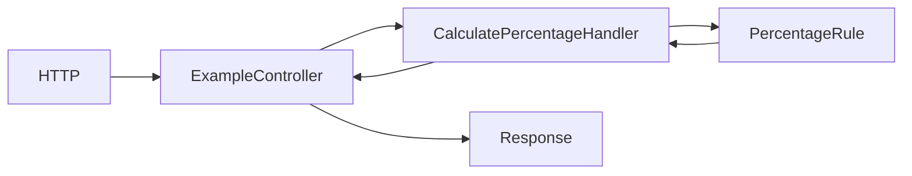

# Architecture

Clean Architecture places the independent Domain at the center. Application coordinates use cases and depends on Domain; Infrastructure implements technical dependencies; each API is a composition root and may reference Infrastructure for setup. Angular is the visual View. MVC controllers bind HTTP models, map them to application inputs, invoke handlers, and map outputs; application models and domain rules know neither HTTP nor persistence. No Razor views are used.

`src` contains Domain and Application directly, Infrastructure and Presentation in their own directories. Each API owns its middleware; this small duplication avoids coupling the APIs or adding a shared project. Npgsql's singleton data source is the ADO.NET entry point. Customer creation uses a focused repository abstraction and parameterized SQL. JWT bearer validation requires an externally supplied issuer, audience and signing key, validates expiry, and does not issue tokens. The business API can start without JWT settings in Development for local testing; it cannot validate tokens in that mode, and authorization is not bypassed. In all other business API environments, and in the identity API, JWT settings are required. Swagger v1 is exposed in Development and includes a Bearer scheme.

The APIs use HTTP; TLS termination is intended to be configured in Nginx later. Forwarded headers and trusted proxy settings will need to be configured when that proxy is introduced. Request logging wraps exception handling so it observes the resulting status. It uses structured logs, a trace scope and route templates rather than query strings or request bodies. Exception middleware converts the example's FluentValidation failure to 400 and unexpected exceptions to safe 500 ProblemDetails; it propagates client cancellation and exceptions after a response starts. Authentication and authorization handle their own failures. ProblemDetails includes a trace identifier shared with logs. MVC model binding and application validation use traceable ValidationProblemDetails.

The example is temporary and has no database dependency. See the development guide for removal.

Customer has seven properties: Id, Name, TradeName, CustomerType, TaxId, Email, and Version. The Domain generates an opaque Guid on creation and preserves it during reconstitution. A Guid provides a new token without a sequence or timestamp and maps directly to PostgreSQL UUID. Infrastructure persists it in a parameterized Npgsql insert. PostgreSQL's named unique constraint resolves concurrent duplicate tax IDs, which the API maps to 409. MVC and application validation return traceable ProblemDetails. The anonymous endpoint is temporary and must be secured before production. The Location header points to the customer-by-ID route.

Customer listing uses an input-free application handler and the same customer repository and Npgsql data source. The repository materializes customers from one query ordered by name and ID. Domain reconstitution preserves persisted identifiers, versions, and text. The handler maps entities to immutable application outputs, and the controller maps those outputs to a response array. The request cancellation token reaches the database reader. Existing middleware handles unexpected errors and request logging. Anonymous access is temporary.

Customer retrieval binds the path value to a UUID in MVC and validates that it is non-empty in Application. It uses the same repository, data source, and row mapping as the list operation. The repository returns null for a missing primary-key match. The handler raises `CustomerNotFoundException` and the Web API middleware returns traceable 404 ProblemDetails. Request logging observes the final status and uses the route template. The operation is temporarily anonymous.
