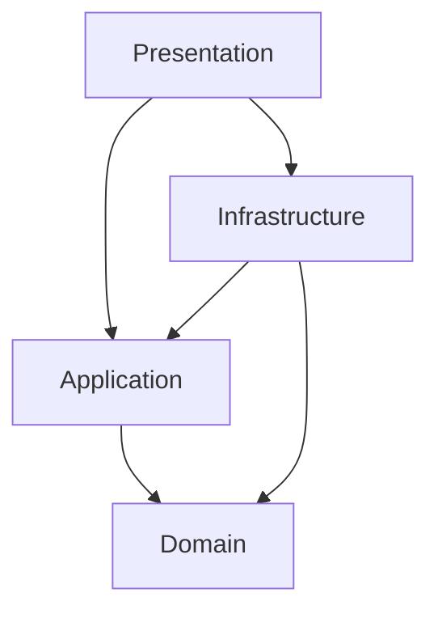
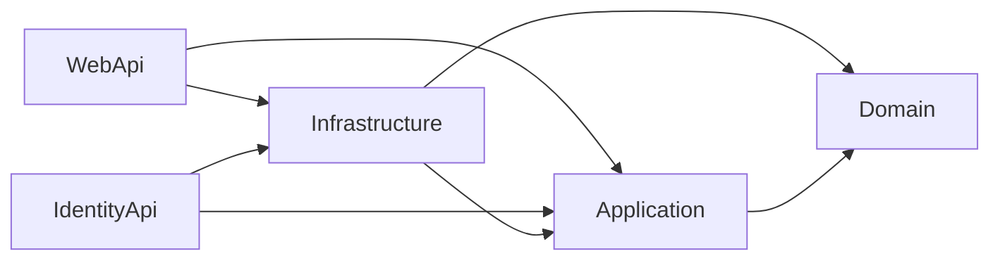
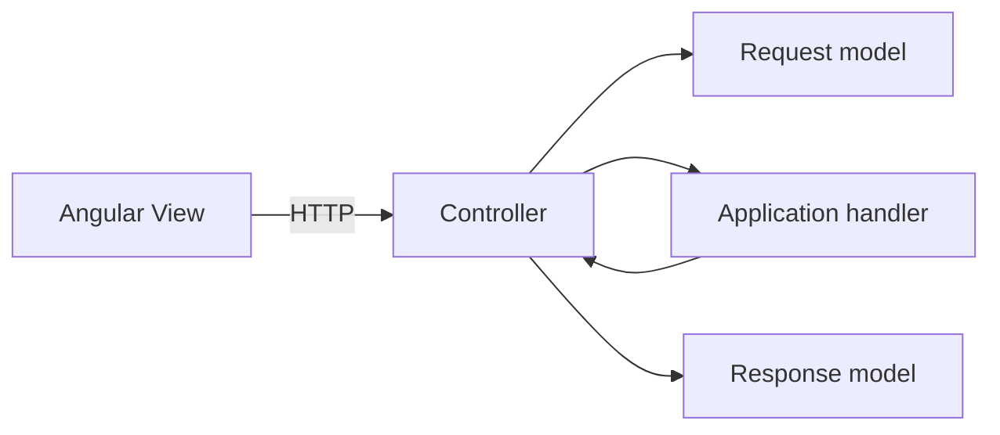
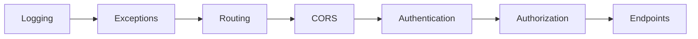
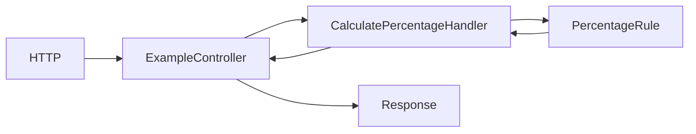

# Architecture

Clean Architecture places the independent Domain at the center. Application coordinates use cases and depends on Domain; Infrastructure implements technical dependencies; each API is a composition root and may reference Infrastructure for setup. Angular is the visual View. MVC controllers bind HTTP models, map them to application inputs, invoke handlers, and map outputs; application models and domain rules know neither HTTP nor persistence. No Razor views are used.

`src` contains Domain and Application directly, Infrastructure and Presentation in their own directories. Each API owns its middleware; this small duplication avoids coupling the APIs or adding a shared project. Npgsql's singleton data source is the ADO.NET entry point. Customer creation uses a focused repository abstraction and parameterized SQL. The IdentityApi issues access tokens. The WebApi validates those tokens locally and requires authentication by fallback policy. Both hosts require a shared issuer, audience and Base64 signing key at startup. Swagger v1 is exposed in Development and includes a Bearer scheme.

The APIs use HTTP; TLS termination is intended to be configured in Nginx later. Forwarded headers and trusted proxy settings will need to be configured when that proxy is introduced. Request logging wraps exception handling so it observes the resulting status. It uses structured logs, a trace scope and route templates rather than query strings or request bodies. Exception middleware converts the example's FluentValidation failure to 400 and unexpected exceptions to safe 500 ProblemDetails; it propagates client cancellation and exceptions after a response starts. Authentication and authorization handle their own failures. ProblemDetails includes a trace identifier shared with logs. MVC model binding and application validation use traceable ValidationProblemDetails.

The example is temporary and has no database dependency. See the development guide for removal.

Customer has eight properties: Id, Name, TradeName, CustomerType, TaxId, Email, Version, and Active. The Domain initializes Active to true and generates an opaque Guid version on creation. Reconstitution preserves both values. Infrastructure persists the version as PostgreSQL UUID and Active as BOOLEAN in a parameterized Npgsql insert. PostgreSQL's named unique constraint resolves concurrent duplicate tax IDs across all customers, which the API maps to 409. MVC and application validation return traceable ProblemDetails. The Location header points to the customer-by-ID route.

Customer listing uses an input-free application handler and the same customer repository and Npgsql data source. The repository materializes customers from one query ordered by name and ID. Domain reconstitution preserves persisted identifiers, versions, and text. The handler maps entities to immutable application outputs, and the controller maps those outputs to a response array. The request cancellation token reaches the database reader. Existing middleware handles unexpected errors and request logging.

Customer retrieval binds the path value to a UUID in MVC and validates that it is non-empty in Application. It uses the same repository, data source, and row mapping as the list operation. The repository returns null for a missing primary-key match. The handler raises `CustomerNotFoundException` and the Web API middleware returns traceable 404 ProblemDetails. Request logging observes the final status and uses the route template.

Customer update normalizes and validates the replacement in Application. The handler loads the customer directly through the repository and rejects an already stale token. The Domain validates the full proposed state before changing any property, preserves the identifier and generates a new non-empty version. The repository receives that proposed state and the original expected version separately. It issues one parameterized PostgreSQL UPDATE whose predicate matches both the primary key and the expected version. This makes the version check and write atomic even when two handlers read the same version.

One affected row confirms the update and allows the handler to return the new version. Zero rows cause one diagnostic lookup, which distinguishes missing customers from conflicts using the state visible at that moment. A concurrent operation can change that observed state again. Other affected-row counts are internal failures. The existing tax ID constraint remains authoritative and a duplicate leaves the row and its version intact. The Web API maps the two conflict types to distinct ProblemDetails identifiers and logs the final status with the request trace.

Customer deletion is a soft delete so the row, identifier, and business data remain available through both GET endpoints. Only GET responses expose the boolean `active`. The Domain deactivates an active customer and renews its version. Application checks the client version first and skips persistence for an already inactive customer with a matching version. Infrastructure atomically matches the identifier, expected version and active state before writing the new status and version. Zero affected rows trigger one diagnostic lookup as in PUT. Competing PUT and DELETE writes for the same active version cannot both persist. PUT changes editable business data and renews the version while preserving activation status.

User is an independent Domain entity with identity, name, normalized email, password hash and activation state. The scoped Npgsql repository implements the Application persistence interface using the existing data source. It inserts all five fields and reads by normalized email, including inactive users. PostgreSQL enforces unique email across concurrent inserts. Infrastructure translates only the named email conflict to the Application duplicate-user exception and keeps raw database diagnostics out of User persistence errors. The hash belongs to this internal boundary.

The IdentityApi binds a login request and calls the Application login handler. The handler validates input, reads the User, verifies the exact password and issues an access token only for an active authenticated account. Infrastructure adapts Microsoft's PasswordHasher and JWT library. Verification uses the persisted User, and provisioning and dummy verification pass a null user to the stock hasher because it does not use the argument. The dummy hash is generated once at IdentityApi startup to reduce work-factor differences for missing accounts, without guaranteeing equal timing. Successful legacy hashes are accepted and updates are deferred.

The WebApi validates HS256, issuer, audience, signature and expiration locally with 30 seconds of clock skew and uses `sub` as the user identifier. Its fallback policy protects Customer operations and health is explicitly anonymous. Each host retains its own middleware. The shared symmetric key means either host can technically sign tokens. Issued tokens remain valid until expiry even when a user becomes inactive.

An MVC authorization filter challenges Customer writes when the authenticated principal lacks a single non-empty UUID subject. The controller passes that ID explicitly to the Application handler and on to the repository. Authorship is persistence metadata. The parameterized INSERT sets the creator, and the version-guarded UPDATE statements record the last modifier atomically with the business change. The two foreign keys reference users in the shared database and restrict deletion of referenced accounts.

The standalone Angular root hosts public and authenticated layouts. The login form calls IdentityApi and the private layout lazy-loads the dashboard. Angular environments supply separate same-origin proxy prefixes that the development server and Compose Nginx map to the two API hosts. In Compose, the `web` container serves the production build and checks its static entry point and both proxied health endpoints. AuthState owns the current session and its timer in memory. The client uses the shorter of the response lifetime and the JWT expiry to end the session. Guards control navigation. WebApi remains responsible for validating the JWT and authorizing business requests. The interceptor scopes the token to configured Customer routes and associates a protected 401 with the session that sent the request.

The private layout also lazy-loads Customer management. Its typed HTTP service uses the Business API configuration and the existing interceptor. The Angular feature keeps local UI state in signals and cancels obsolete reads through RxJS. A shared reactive editor maps editable fields to create and update requests. The editor and deactivation dialog retain the version received from the API and classify conflicts by ProblemDetails type. Read models expose activation status and the UI reads it again after a successful mutation.
